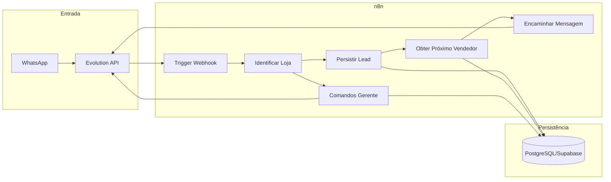

# Planejamento: Fluxos n8n para Sistema de Distribuição de Leads

Documento que consolida o plano de implementação do workflow n8n "Distribuição de Leads" no **Sistema de Distribuição Automática de Leads via WhatsApp** (versão atual). Serve como referência para desenvolvimento e validação.

**Documento comercial:** [[../📄 Documento Comercial]] — define o problema, a solução, como funciona na prática, distribuição Round-Robin, uso 100% pelo WhatsApp, multi-loja e escopo V1 (o que está e o que não está incluído).

---

## Alinhamento com requisitos e escopo (Documento Comercial)

O plano abaixo foi revisado contra o Documento Comercial e a documentação técnica/regras de negócio:

| Requisito / Escopo (Documento Comercial) | Atendimento no plano n8n |
| ----------------------------------------- | ------------------------- |
| Receber automaticamente mensagens das plataformas (OLX, Webmotors etc.) | Trigger por webhook; mensagens chegam no WhatsApp da loja e são recebidas via Evolution API → n8n. |
| Distribuir cada novo contato para o “vendedor da vez” | Fluxo principal: obter próximo vendedor (Round-Robin) → encaminhar mensagem ao vendedor. |
| Funcionar 100% no WhatsApp; vendedor não aprende novo app | Entrada e saída só via WhatsApp (Evolution API); sem dashboard nem app próprio no sistema. |
| Distribuição justa (um lead por vez, próximo na fila) | Round-Robin implementado na persistência; n8n invoca e encaminha. |
| Gerente e vendedor acompanham pelo WhatsApp; comandos retornam status e lista de leads | Fluxo de comandos: `status` e `leads`; números cadastrados como gerente ou vendedor; respostas escopadas por loja. |
| Uma solução por loja (multi-loja); dados não se misturam | Identificação da loja no início; todas as consultas e escritas filtradas por `loja_id`. |
| Número do WhatsApp é canal; troca de número não perde dados | Identificação da loja por mapeamento (instância/número → loja) na persistência. |
| Versão atual: distribuição automática, Round-Robin, cadastro de vendedores, relatórios básicos via WhatsApp | Plano cobre todos; cadastro de vendedores/gerentes feito pelo operador (fora do n8n). |
| V1 sem: dashboard complexo, app mobile, IA avançada, relatórios históricos detalhados | Nenhum nó de IA; sem dashboard; relatórios apenas os definidos (status, relatorio no dia). |

**Conclusão da revisão:** o plano atende aos requisitos e ao escopo da solução descritos no Documento Comercial e nas regras de negócio/operação do vault.

---

## Contexto (resumo da documentação)

O sistema é multi-tenant (uma **loja** = um tenant). Toda mensagem entra pelo WhatsApp (Evolution API); o n8n orquestra: identificar loja → persistir → escolher vendedor (Round-Robin só entre ativos) → encaminhar. Comandos de gerente e vendedor (`status`, `leads`) são tratados no mesmo trigger com ramificação. A **lógica de Round-Robin e estados do vendedor** deve ficar em serviço/banco (ex.: Supabase/PostgreSQL), e o n8n apenas **invoca** e usa os resultados. Ver [[../Técnica/04 - Stack e Decisões Técnicas]].

---

## Estado atual do n8n (via MCP)

Consulta feita via n8n MCP na instância em uso:

- **Instância:** https://n8n.yavoh.cloud — status OK, versão n8n 2.34.4 (atual).
- **Workflow "Distribuição de Leads":**
  - **ID:** `XYaAkGd7lz-TsGAo6DzOM`
  - **Estado:** vazio (0 nós), inativo, executionOrder `v1`.
  - **Validação:** workflow válido; aviso de que não há nós e sugestão de adicionar trigger (ex.: Webhook) e tratamento de erros.
- **Referência na mesma instância:** o workflow **"Agente WhatsApp V3"** (ID `4ZawPyhVaRC6mLpD`) já usa:
  - **Webhook** como trigger.
  - **HTTP Request** para "Envia Mensagem para Evolution API".
  - Set, Switch, Redis, etc.  
  Padrão a seguir para este projeto: **Webhook** como entrada e **HTTP Request** (ou nó Evolution da comunidade) para enviar mensagens via Evolution API.
- **Nós úteis disponíveis:**
  - **Webhook** (`n8n-nodes-base.webhook`) — trigger por chamada HTTP (Evolution API pode apontar o webhook para esta URL).
  - **HTTP Request** (`n8n-nodes-base.httpRequest`) — para chamadas à Evolution API e ao backend (Supabase/PostgreSQL).
  - **Evolution (comunidade)** (`n8n-nodes-evolution.evolution`) — nó específico Evolution API versão futura (130+ operações); alternativa ao HTTP Request para envio/recebimento WhatsApp.
- **Boas práticas do projeto:** [[02 - Sistema de Distribuição de Leads/docs/N8N_DOCUMENT/N8N-MCP]] define processo com templates first, validação em níveis (validate_node minimal → full → validate_workflow), e **parâmetros explícitos** (nunca confiar em defaults). Aplicar ao construir os nós do "Distribuição de Leads".

**Conclusão para o planejamento:** o workflow alvo já existe e está vazio; a implementação deve adicionar nós nesse workflow (`XYaAkGd7lz-TsGAo6DzOM`), começando por um trigger Webhook e seguindo a arquitetura abaixo. Usar o mesmo padrão de integração com Evolution API já usado no "Agente WhatsApp V3" (Webhook + HTTP Request) garante consistência na instância.

---

## Arquitetura de alto nível



---

## 1. Trigger e entrada

- **Fonte:** evento “mensagem recebida” da Evolution API.
- **No n8n:** usar **Webhook** (POST) como trigger, configurado para ser chamado pela Evolution API quando chegar mensagem no número/instância da loja (webhook da Evolution apontando para a URL do n8n).
- **Payload esperado:** o formato depende da Evolution API (ex.: `instance`, `data.from`, `data.body`, etc.). O fluxo deve normalizar esse payload para: origem (número/instância), remetente, corpo da mensagem, e qualquer metadado necessário para identificar a loja.
- **Decisão de desenho:** um único webhook que recebe todas as mensagens e, no próprio fluxo, bifurca entre “mensagem de lead” (canal da loja) e “possível comando de gerente” (mensagem enviada por um número que pode ser gerente). Um webhook único com ramificação é suficiente paro sistema.

---

## Exemplo de mensagem que chega no WhatsApp (webhook Evolution API)

A Evolution API envia eventos para a URL do webhook configurada. Para **mensagens recebidas**, o evento é **`MESSAGES_UPSERT`**. O n8n deve estar configurado para receber POST nessa URL (ou na URL específica por evento, se `webhook_by_events: true` — ex.: `.../webhook/messages-upsert`).

### Evento e fonte

- **Evento:** `MESSAGES_UPSERT` — notifica quando uma mensagem é recebida no número/instância conectado.
- **Documentação Evolution API v2:** [Webhooks](https://doc.evolution-api.com/v2/en/configuration/webhooks).

### Estrutura típica do payload (referência)

O corpo do POST contém, em geral, dados da instância e do evento. Abaixo um **exemplo de referência** dos campos mais relevantes para o fluxo de distribuição de leads (a estrutura exata pode variar conforme versão da Evolution API; validar com o payload real da sua instalação):

```json
{
  "instance": "nome-da-instancia",
  "event": "messages.upsert",
  "data": {
    "key": {
      "remoteJid": "5511999999999@s.whatsapp.net",
      "fromMe": false,
      "id": "mensagem-id-interno"
    },
    "message": {
      "conversation": "Oi, tenho interesse no anúncio do Corolla 2020"
    },
    "messageTimestamp": "1736280000",
    "pushName": "João Silva"
  }
}
```

### Campos úteis para o fluxo n8n

| Campo (exemplo) | Uso no fluxo |
| -----------------| ------------- |
| `instance` (ou equivalente) | Identificar a loja via mapeamento instância/número → loja. |
| `data.key.remoteJid` | Número do remetente (quem enviou). Para lead: cliente; para comando: possível gerente. Normalizar para comparação com gerentes cadastrados (ex.: remover sufixo `@s.whatsapp.net`). |
| `data.key.fromMe` | Se `true`, mensagem enviada pela própria instância; normalmente leads têm `fromMe: false`. |
| `data.message.conversation` (ou `extendedTextMessage.text`, etc.) | Texto da mensagem. Para lead: extrair nome/telefone/anúncio quando aplicável; para comando: verificar se é `status` ou `relatorio`. |
| `data.pushName` | Nome exibido do contato (pode ser usado como nome do lead quando disponível). |
| `data.messageTimestamp` | Data/hora da mensagem (persistir no lead). |

### Observações

- **Mensagens que não são texto** (imagem, áudio, etc.): a estrutura pode trazer `data.message.imageMessage`, `audioMessage`, etc. No sistema a doc não exige interpretação de mídia; o fluxo pode persistir o lead e encaminhar a mensagem como está (Evolution API pode permitir encaminhar o objeto completo) ou tratar apenas mensagens de texto, conforme decisão técnica.
- **Anexar exemplo real:** quando você tiver um payload real de produção (capturado pelo webhook), substitua ou complemente o JSON acima neste documento para refletir exatamente os campos da sua Evolution API e facilitar a configuração dos nós (Set/Code) de extração.

---

## 2. Identificação da loja

- **Objetivo:** a partir do evento (ex.: instância, número do canal onde a mensagem chegou), obter o `id` (ou identificador) da **loja**.
- **Implementação no n8n:**
  - Consultar persistência (Supabase/PostgreSQL) onde exista **mapeamento** “instância ou número do WhatsApp → loja”. Pode ser tabela `lojas` com campo de instância/número, ou tabela de configuração `canal_whatsapp` com `instancia`/`numero` e `loja_id`.
  - Se **não houver loja** para aquele canal: tratar como “indeterminação da loja” ([[../Operação/04 - Tratamento de Erros]]): não distribuir, opcionalmente registrar para análise ou descartar; encerrar o fluxo para esse item.
- **Isolamento:** daqui em diante, todo uso de dados (leads, vendedores, fila) deve ser **sempre** filtrado por essa loja.

---

## 3. Ramificação: comando vs lead

- **Regra:** números **cadastrados como gerente ou vendedor** da loja executam comandos ([[../Operação/02 - Comandos via WhatsApp]]).
- **Lógica no n8n:**
  - Usar o **número do remetente** da mensagem (quem enviou).
  - Verificar se é gerente → se sim, tratar como comando.
  - Se não é gerente, verificar se é vendedor → se sim, tratar como comando.
  - Se não é gerente nem vendedor → tratar como **lead** → seguir para extração, persistência e Round-Robin.
- **Detalhe:** a ramificação é: "remetente = gerente?" → comando; "remetente = vendedor?" → comando; senão → lead.

---

## 4. Fluxo principal (lead)

Sequência alinhada a [[../Técnica/03 - Fluxos Técnicos (n8n)]] e [[../Operação/01 - Fluxo Principal]]:

1. **Extrair dados do lead**  
   Nome, telefone, anúncio (quando aplicável) a partir do payload da mensagem. Formato fixo no sistema (sem IA); extração por campos/estrutura conhecida.

2. **Persistir lead**  
   Inserir em tabela de leads com: data/hora, número do cliente, dados extraídos, `loja_id`. Ainda **sem** vendedor atribuído. Isolamento: sempre com `loja_id` da etapa 2.

3. **Obter próximo vendedor (Round-Robin)**  
   Chamar serviço/lógica centralizada (ex.: função no Supabase ou API) que: recebe `loja_id`; considera apenas vendedores **ativos** ([[../Regras de Negócio/03 - Estados do Vendedor]]); retorna o próximo da fila Round-Robin e avança o ponteiro. O n8n não implementa a regra de Round-Robin; apenas chama e usa o retorno ([[../Regras de Negócio/01 - Distribuição de Leads (Round-Robin)]]).

4. **Se há vendedor:**  
   Encaminhar mensagem ao vendedor via Evolution API; atualizar lead na persistência (associar ao vendedor). Se a “avançar fila” não for feita dentro da função de Round-Robin, o n8n chama outra ação (ex.: marcar lead como distribuído e avançar ponteiro).

5. **Se não há vendedor ativo:**  
   Conforme [[../Operação/04 - Tratamento de Erros]]: não encaminhar; lead já persistido pode ficar com indicação “não distribuído”; opcionalmente notificar gerente ou registrar para retry/tratamento manual.

6. **Falha no envio ao vendedor:**  
   Manter consistência da fila e rastreabilidade (ex.: retentar envio, ou marcar lead como falha e não avançar o ponteiro, conforme decisão de implementação).

---

## 5. Dados e persistência (visão para o n8n)

- **Entidades utilizadas pelo fluxo:** loja (com mapeamento canal → loja), vendedor (nome, número WhatsApp, status, loja), gerente (número, loja(s)), lead (data/hora, número cliente, loja, vendedor atribuído ou “não distribuído”), estado da fila Round-Robin por loja (ordem dos ativos + ponteiro).
- **Modelo completo:** [[../Técnica/02 - Modelo Mental de Dados]].
- O n8n fará **chamadas** a Supabase (ou outro backend): inserts/updates de leads; chamada à “função” que retorna o próximo vendedor e atualiza a fila; consultas para identificar loja e gerente.

---

## 6. Integração Evolution API (uso no n8n)

- **Receber:** mensagens chegam via webhook que a Evolution API chama (n8n expõe a URL).
- **Enviar:** n8n usa nó HTTP Request (ou conector Evolution API se existir) para: enviar a mensagem do lead ao número do vendedor; enviar resposta ao gerente nos comandos `status` e `relatorio`.
- **Identificação da loja:** feita no n8n com base em mapeamento configurado na persistência ([[../Técnica/05 - Integração Evolution API]]).

---

## 7. Fluxo de comandos (gerente e vendedor)

- **Entrada:** mensagem de número validado como gerente ou vendedor de uma loja; texto do comando: `status` ou `leads` (fixos, sem IA).
- **status** ([[../Operação/02 - Comandos via WhatsApp]]): buscar na persistência (sempre filtrado pela loja): total de leads no dia, distribuição por vendedor, próximo da fila, último horário de recebimento. Montar mensagem de resposta e enviar via Evolution API para o número do remetente.
- **leads:** buscar lista detalhada dos leads recebidos no dia (loja do remetente). Montar mensagem e enviar ao remetente.
- Qualquer outro texto ou comando não reconhecido: responder com mensagem padrão "Comando não reconhecido. Comandos disponíveis: status, leads".

---

## 8. Ordem de implementação sugerida

**Workflow de destino:** usar o workflow existente "Distribuição de Leads" (ID `XYaAkGd7lz-TsGAo6DzOM`); adicionar nós via MCP com `n8n_update_partial_workflow` (operação `addNode`) ou atualizar estrutura completa com `n8n_update_full_workflow`. Validar após cada alteração com `n8n_validate_workflow(id)`.

1. **Persistência e mapeamento** — Garantir que existem: tabela/estrutura de lojas com mapeamento canal (instância/número) → loja; vendedores (com status ativo/inativo/removido); gerentes por loja; leads; e lógica/função de Round-Robin por loja (obter próximo + avançar).
2. **Webhook e identificação** — Criar workflow n8n com Webhook; normalizar payload; nó que identifica a loja a partir do canal (e encerra se não houver loja).
3. **Ramificação lead vs comando** — Implementar a lógica “remetente é gerente?” e “mensagem no canal da loja?” para direcionar para o fluxo de lead ou para o fluxo de comandos.
4. **Fluxo principal (lead)** — Implementar: extração → persistir lead → chamar Round-Robin → se houver vendedor, enviar via Evolution API e atualizar lead; se não houver, marcar como não distribuído; tratar falha de envio de forma simples e consistente.
5. **Fluxo de comandos** — Implementar `status` e `relatorio` com consultas escopadas à loja do gerente e envio da resposta via Evolution API.
6. **Tratamento de erros** — Revisar nós com tratamento explícito: indeterminação de loja, sem vendedor ativo, comando não autorizado, falha de envio ([[../Operação/04 - Tratamento de Erros]]).

---

## 9. Checklist de conformidade V1

- Isolamento: todas as leituras/escritas por loja.
- Round-Robin apenas entre vendedores ativos; inativos e removidos fora da fila.
- Comandos para números cadastrados como gerente ou vendedor; respostas escopadas pela loja do remetente.
- Sem dashboard, sem IA para interpretar mensagens, sem integração direta com OLX/Webmotors (entrada só WhatsApp).
- Tratamento de erros conforme doc: sem vendedor, comando não autorizado, falha de envio, indeterminação de loja.

---

## Resumo dos nós n8n (conceitual)

| Etapa                       | Tipo de nó (sugestão)                            |
| --------------------------- | ------------------------------------------------ |
| Entrada                     | Webhook                                          |
| Identificar loja            | HTTP Request / Supabase (consulta mapeamento)    |
| Ramificação lead/comando    | IF / Switch (remetente = gerente? canal = loja?) |
| Extrair dados do lead       | Code ou Set (campos do payload)                  |
| Persistir lead              | HTTP Request / Supabase (insert)                 |
| Próximo vendedor            | HTTP Request / Supabase (RPC ou endpoint)        |
| Encaminhar ao vendedor      | HTTP Request (Evolution API)                     |
| Atualizar lead com vendedor | HTTP Request / Supabase (update)                 |
| Comandos: buscar dados      | HTTP Request / Supabase (consultas por loja)     |
| Resposta ao gerente/vendedor | HTTP Request (Evolution API send)                |

---

Este plano mantém o escopo estrito do sistema e usa a documentação do vault como única fonte das regras de negócio. Foi revisado contra o [[../📄 Documento Comercial]], os documentos em [[../Técnica]], [[../Regras de Negócio]] e [[../Operação]], e está alinhado aos requisitos e ao escopo da solução (seção “Alinhamento com requisitos e escopo” no início deste documento).
